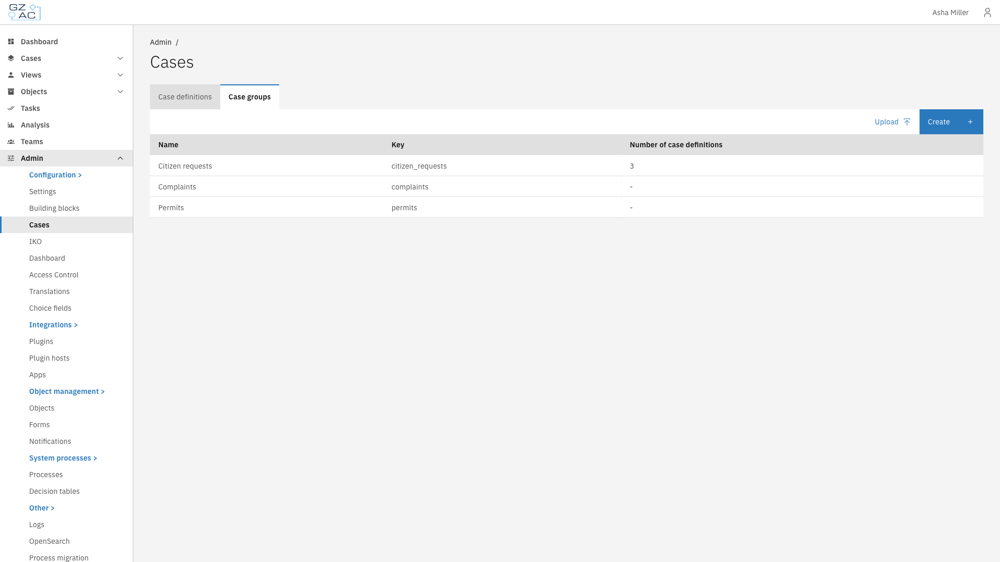
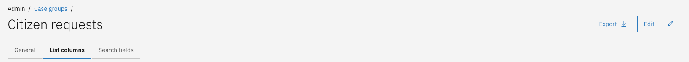
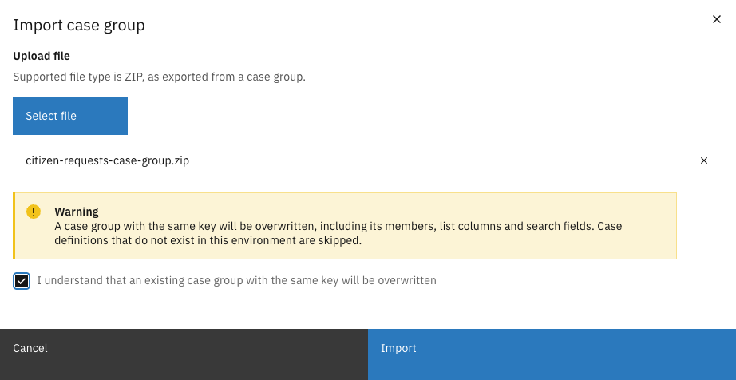

# Case groups


Available since Valtimo `13.53.0`


A case group combines several case definitions into one shared case list, so users can work on
related cases from a single place.

Each case group has its own list columns and search fields. Because every case definition has its
own document structure, a column or search field in a group is mapped to a path per case
definition. For example, the applicant name can be stored in `doc:achternaam` in one case
definition and in `doc:aanvrager.naam` in another, and still be shown in one **Applicant** column.

This includes:

- **[General](configuration.md)** — Creating a case group, choosing its color, and adding case definitions
- **[List columns](list-columns.md)** — Columns displayed in the case list of the group
- **[Search fields](search-fields.md)** — Search fields available for filtering the case list of the group

---

## Configuring case groups



Expand **Admin** in the left sidebar


Click **Cases** under the Configuration section


Click the **Case groups** tab

<figure><figcaption>Case groups tab</figcaption></figure>


Click a case group to open it, or click **Create** to add a new one



The list shows all case groups with their name, key, and the number of case definitions in each
group.

The detail page of a case group has three tabs: **General**, **List columns**, and **Search
fields**. The **Edit** and **Export** buttons in the header are available on every tab.


Case groups are not versioned. A case group refers to case definitions by key, so its
configuration applies to all versions of those case definitions.


### Exporting a case group

A case group can be exported to a ZIP file and imported in another environment, for example to
move a configuration from a test environment to production. The export contains the complete
configuration of the case group:

| Included | Description |
|----------|-------------|
| General | Key, name, description, and color |
| Case definitions | The keys of the case definitions in the group |
| List columns | All columns, including their path per case definition |
| Search fields | All search fields, including their path per case definition |

Cases are not part of the export.



Click a case group to open it


Click **Export** in the header

<figure><figcaption>Export button</figcaption></figure>



The browser downloads a ZIP file with the configuration of the case group.

### Uploading a case group



Click **Upload** in the toolbar


Click **Select file**


Select a ZIP file exported from a case group


Read the warning and select **I understand that an existing case group with the same key will be
overwritten**

<figure><figcaption>Import case group</figcaption></figure>


Click **Import**




If a case group with the same key already exists, it is overwritten, including its case
definitions, list columns, and search fields.



Case definitions that do not exist in the target environment are skipped. Import or create these
case definitions first, then import the case group again.


---

## Access for end users

Case groups have no separate permissions. Visibility follows the existing `view_list` permission on
case definitions (see [Access control](../../access-control/README.md)):

- A user sees a case group when they are allowed to view the case list of at least one case
  definition in the group.
- The case list of a group only shows cases of the case definitions the user is allowed to view.
- When starting a case from a group, the user can only choose case definitions they are allowed to
  start.
