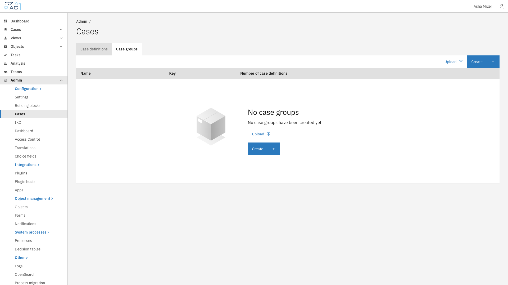
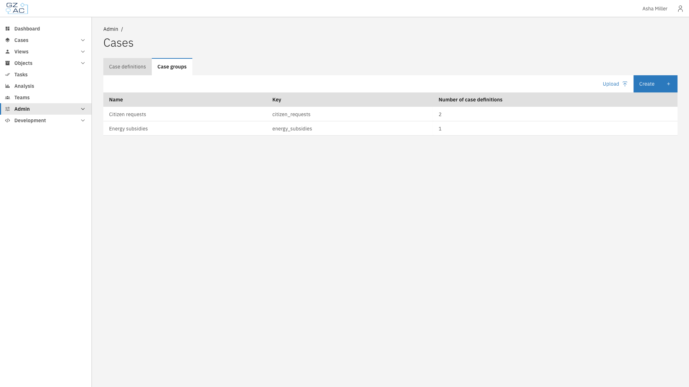

# Case groups


Available since Valtimo `13.52.0`


A case group combines several case definitions into one shared case list, so users can work on
related cases from a single place.

Each case group has its own list columns and search fields. Because every case definition has its
own document structure, a column or search field in a group is mapped to a path per case
definition. For example, the applicant name can be stored in `doc:achternaam` in one case
definition and in `doc:aanvrager.naam` in another, and still be shown in one **Applicant** column.

End users open case groups from the [Cases overview](../cases-overview.md) and can pin them to the
left sidebar.

This includes:

- **[Configuration](configuration.md)** — Creating a case group, choosing its color, and adding case definitions
- **[List columns](list-columns.md)** — Columns displayed in the case list of the group
- **[Search fields](search-fields.md)** — Search fields available for filtering the case list of the group
- **[Import and export](import-export.md)** — Moving a case group to another environment

---

## Configuring case groups



Expand **Admin** in the left sidebar


Click **Cases** under the Configuration section


Click the **Case groups** tab

<figure><figcaption>Case groups tab</figcaption></figure>


Click a case group to open it, or click **Create** to add a new one



The list shows all case groups with their name, key, and the number of case definitions in each
group.

<figure><figcaption>Case groups list</figcaption></figure>

The detail page of a case group has three tabs: **Config**, **List columns**, and **Search
fields**. The **Edit** and **Export** buttons in the header are available on every tab.


Case groups are not versioned. A case group refers to case definitions by key, so its
configuration applies to all versions of those case definitions.


---

## Access for end users

Case groups have no separate permissions. Visibility follows the existing `view_list` permission on
case definitions (see [Access control](../../access-control/README.md)):

- A user sees a case group when they are allowed to view the case list of at least one case
  definition in the group.
- The case list of a group only shows cases of the case definitions the user is allowed to view.
- When starting a case from a group, the user can only choose case definitions they are allowed to
  start.
