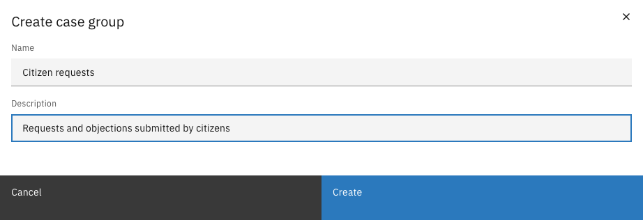
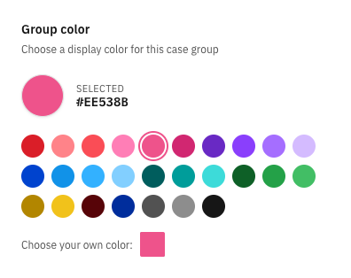
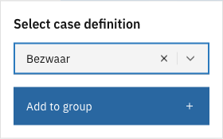
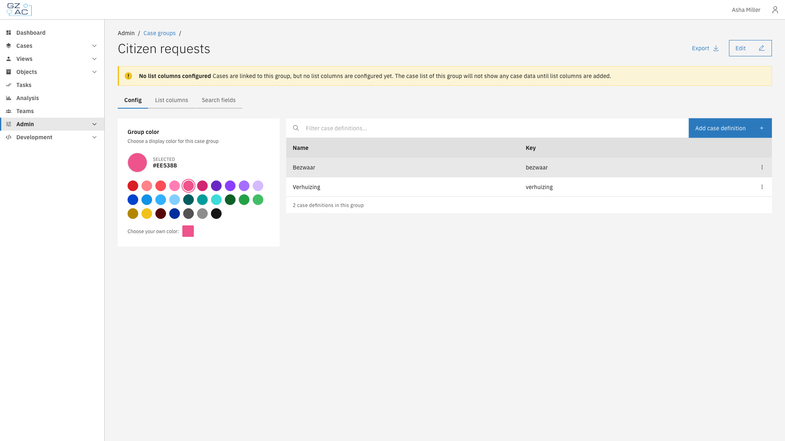

# Configuration


Available since Valtimo `13.52.0`


The **Config** tab of a case group defines which case definitions belong to the group and which
color represents the group in the Cases overview and the left sidebar.

---

## Creating a case group



Go to **Admin** > **Cases** and click the **Case groups** tab


Click **Create**


Fill in the name and, optionally, a description

<figure><figcaption>Create case group</figcaption></figure>


Click **Create**



| Property | Description |
|----------|-------------|
| Name | Display name of the case group. Required. |
| Description | Short explanation shown on the case group tile in the Cases overview. Optional. |

The key of the case group is generated from the name (for example, `citizen_requests` for
"Citizen requests") and cannot be changed.

### Editing a case group

Open the case group and click **Edit** in the header to change the name or description. Click
**Save** to apply the changes.

---

## Choosing a group color

The **Group color** panel sets the color used for the case group tile in the Cases overview and
for the dot in front of the pinned case group in the left sidebar.

<figure><figcaption>Group color</figcaption></figure>

Click one of the predefined colors, or click the square next to **Choose your own color** to pick
any color. The color is saved immediately.


Case definitions have a color of their own. It is set in the **Case color** panel on the
[General](../general.md) tab of the case definition.


---

## Adding case definitions



Open the case group and go to the **Config** tab


Click **Add case definition**


Select a case definition and click **Add to group**

<figure><figcaption>Add case definition</figcaption></figure>



The table lists all case definitions in the group with their name and key. Use the
**Filter case definitions...** field to search the table.

<figure><figcaption>Case definitions in a case group</figcaption></figure>


As long as no list columns are configured, the case group shows the warning **No list columns
configured** and its case list shows no case data. Add list columns on the
[List columns](list-columns.md) tab.


### Removing a case definition

Click the overflow menu (**⋮**) of a case definition and select **Delete**. The case definition is
removed from the group immediately, without a confirmation. The case definition itself and its
cases are not affected.
