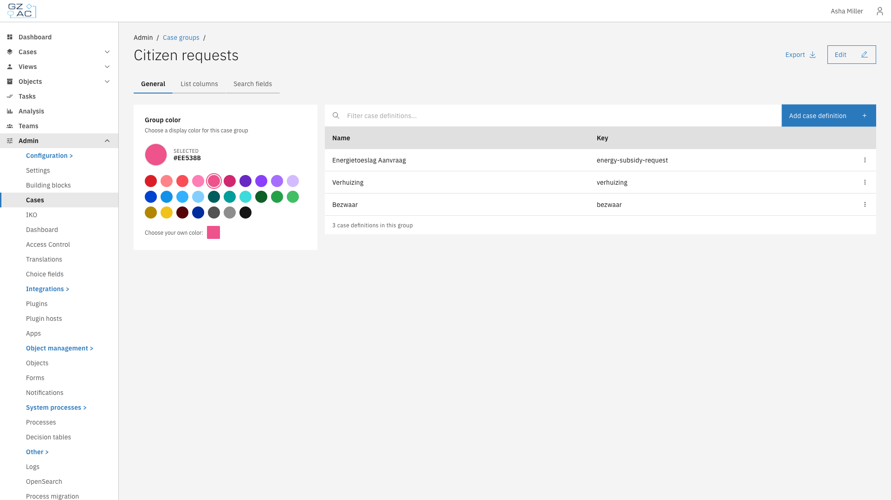
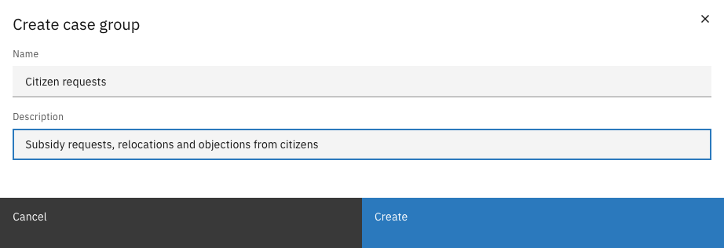
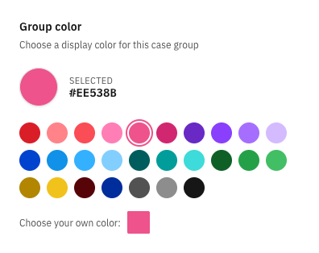
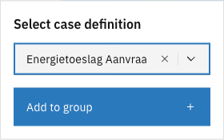
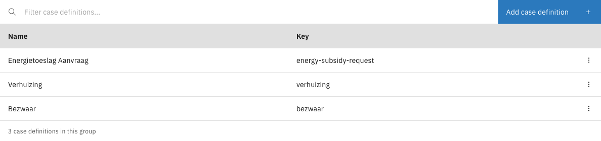

# General


Available since Valtimo `13.53.0`


The **General** tab of a case group defines which case definitions belong to the group and which
color represents the group in the Cases overview and the left sidebar.

---

## Configuring general settings



Expand **Admin** in the left sidebar


Click **Cases** under the Configuration section


Click the **Case groups** tab


Click a case group to open it


Click the **General** tab

<figure><figcaption>General tab overview</figcaption></figure>



---

## Creating a case group



Expand **Admin** in the left sidebar


Click **Cases** under the Configuration section


Click the **Case groups** tab


Click **Create**


Fill in the name and, optionally, a description

<figure><figcaption>Create case group</figcaption></figure>


Click **Create**



| Property | Description |
|----------|-------------|
| Name | Display name of the case group. Required. |
| Description | Short explanation shown on the case group tile in the Cases overview. Optional. |

The key of the case group is generated from the name (for example, `citizen_requests` for
"Citizen requests") and cannot be changed.

### Editing a case group



Open the case group


Click **Edit** in the header


Change the name or description


Click **Save**



---

## Choosing a group color

The **Group color** panel sets the color used for the case group tile in the Cases overview and
for the dot in front of the pinned case group in the left sidebar.

<figure><figcaption>Group color</figcaption></figure>

Click one of the predefined colors, or click the square next to **Choose your own color** to pick
any color. The color is saved immediately and a confirmation appears.

Click **Remove color** to clear the color. The case group then shows the neutral gray dot again.


Case definitions have a color of their own. It is set in the **Case color** panel on the
[General](../general.md) tab of the case definition.


---

## Adding case definitions



Click **Add case definition**


Select a case definition

<figure><figcaption>Add case definition</figcaption></figure>


Click **Add to group**



The table lists all case definitions in the group with their name and key. Use the
**Filter case definitions...** field to search the table.

<figure><figcaption>Case definitions in a case group</figcaption></figure>


As long as no list columns are configured, the case group shows the warning **No list columns
configured** and its case list shows no case data. Add list columns on the
[List columns](list-columns.md) tab.


### Removing a case definition



Click the overflow menu (**⋮**) of a case definition


Select **Delete**



The case definition is removed from the group immediately, without a confirmation. The case definition itself and its
cases are not affected.

---

## Deleting a case group



Open the case group


Click **Delete** in the page header


Click **Delete** in the **Delete case group** dialog to confirm




Deleting a case group cannot be undone. Its list columns, search fields and saved searches are
removed, and it disappears from every user's pinned items. The case definitions in the group and
their cases are not affected.

To keep a copy of the configuration, [export the case group](README.md#exporting-a-case-group)
first.

