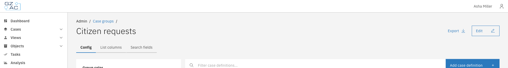
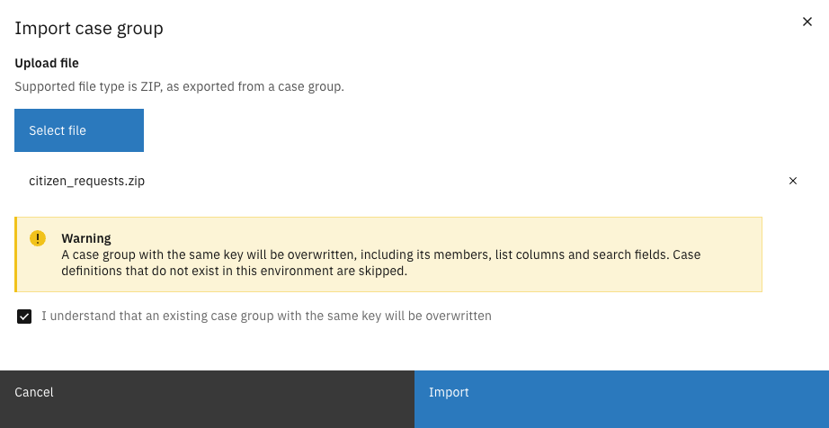

# Import and export


Available since Valtimo `13.52.0`


A case group can be exported to a ZIP file and imported in another environment, for example to
move a configuration from a test environment to production.

The export contains the complete configuration of the case group:

| Included | Description |
|----------|-------------|
| General | Key, name, description, and color |
| Case definitions | The keys of the case definitions in the group |
| List columns | All columns, including their path per case definition |
| Search fields | All search fields, including their path per case definition |

Cases are not part of the export.

---

## Exporting a case group



Go to **Admin** > **Cases** and click the **Case groups** tab


Click a case group to open it


Click **Export** in the header

<figure><figcaption>Export button</figcaption></figure>



The browser downloads a ZIP file with the configuration of the case group.

---

## Importing a case group



Go to **Admin** > **Cases** and click the **Case groups** tab


Click **Upload**


Click **Select file** and select a ZIP file exported from a case group


Read the warning and select **I understand that an existing case group with the same key will be
overwritten**

<figure><figcaption>Import case group</figcaption></figure>


Click **Import**




If a case group with the same key already exists, it is overwritten, including its case
definitions, list columns, and search fields.



Case definitions that do not exist in the target environment are skipped. Import or create these
case definitions first, then import the case group again.

