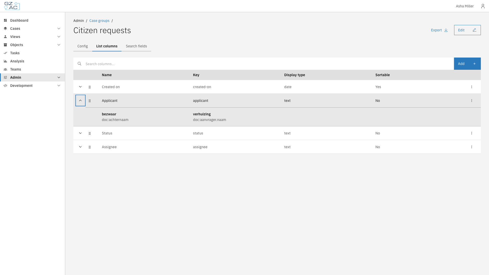
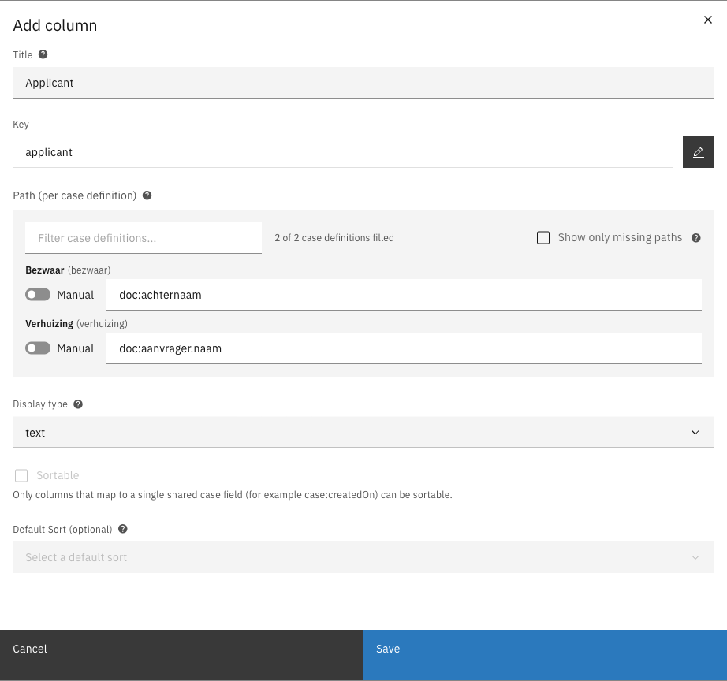

# List columns


Available since Valtimo `13.52.0`


List columns determine which data is shown in the case list of a case group. Each column has one
path per case definition in the group, so the same column can show data that is stored in a
different place in each case definition.

---

## Configuring list columns



Go to **Admin** > **Cases** and click the **Case groups** tab


Click a case group to open it


Click the **List columns** tab



The list shows all columns with their name, key, display type, and whether they are sortable.
Click the arrow in front of a column to see its path for each case definition.

<figure><figcaption>List columns with path mappings</figcaption></figure>


The **Add** button is disabled until the case group contains at least one case definition. Add
case definitions first on the [Config](configuration.md#adding-case-definitions) tab.


### Creating a column



Click **Add**


Fill in the title. The key is generated from the title; click the pencil icon to change it.


Fill in a path for each case definition, either by selecting it from the dropdown or by typing it
after switching on **Manual**

<figure><figcaption>Add column</figcaption></figure>


Select a display type and, if applicable, the sorting options


Click **Save**



#### Column properties

| Property | Description |
|----------|-------------|
| Title | Column header shown in the case list |
| Key | Unique identifier of the column within the group. Generated from the title. |
| Path (per case definition) | Path to the value for each case definition, for example `doc:achternaam` or `case:createdOn`. Use **Filter case definitions...** and **Show only missing paths** to find case definitions without a path. The counter shows how many case definitions have a path. |
| Display type | How the value is shown: text, date, boolean, enum, or tags. Date and tags have extra options for the date format and the number of tags shown. |
| Sortable | Whether users can sort the case list on this column |
| Default sort (optional) | Sort direction used when the case list opens. Only one column can have a default sort. |

#### Path prefixes

| Prefix | Description | Example |
|--------|-------------|---------|
| `doc:` | Field in the case document | `doc:aanvrager.naam` |
| `case:` | Case property | `case:createdOn`, `case:assigneeFullName` |

#### Sortable columns

A column can only be made sortable when every case definition uses the **same case property** as
path. These case properties can be sorted on:

`case:createdOn`, `case:modifiedOn`, `case:createdBy`, `case:sequence`, `case:retentionDate`,
`case:assigneeId`, `case:assigneeFullName`, `case:internalStatus`, and
`case:documentDefinitionId.name`.

Columns that use document fields (`doc:`) cannot be sorted, because the field differs per case
definition.

### Editing or deleting a column

Click the overflow menu (**⋮**) of a column and select **Edit** or **Delete**.

### Reordering columns

Drag the handle in front of a column to change its position in the case list. Reordering is not
available while the search field above the list is in use.
