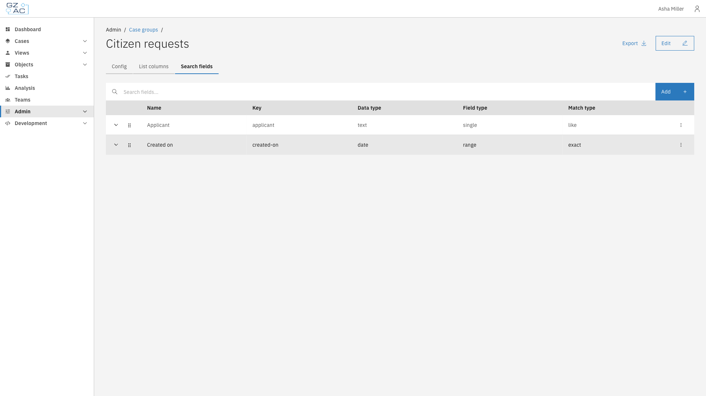
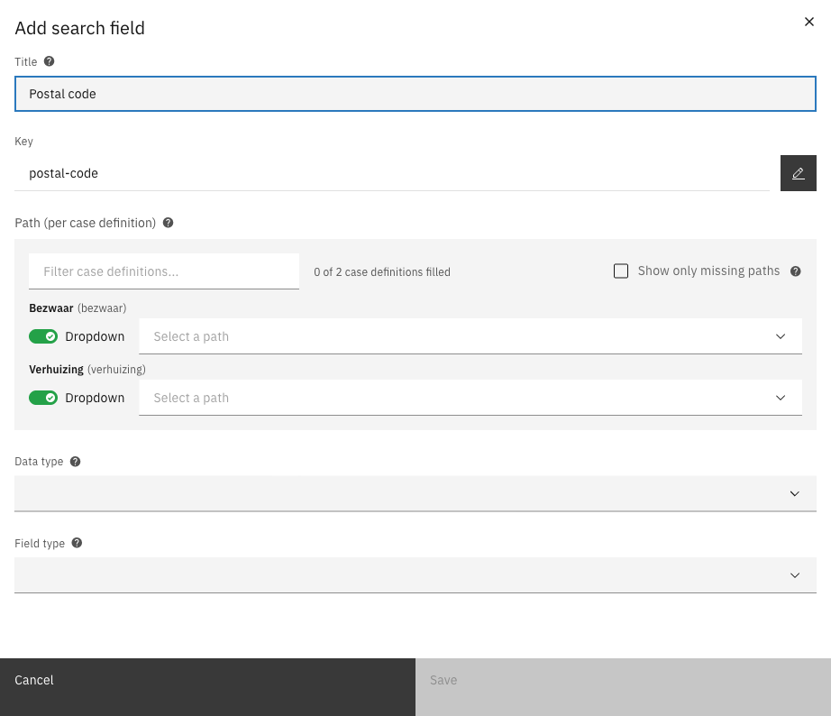

# Search fields


Available since Valtimo `13.52.0`


Search fields determine which filters are available in the case list of a case group. Like list
columns, each search field has one path per case definition, so one filter searches the right
field in every case definition of the group.

---

## Configuring search fields



Go to **Admin** > **Cases** and click the **Case groups** tab


Click a case group to open it


Click the **Search fields** tab

<figure><figcaption>Search fields</figcaption></figure>



The list shows all search fields with their name, key, data type, field type, and match type.
Click the arrow in front of a search field to see its path for each case definition.

### Creating a search field



Click **Add**


Fill in the title. The key is generated from the title; click the pencil icon to change it.


Fill in a path for each case definition

<figure><figcaption>Add search field</figcaption></figure>


Select the data type, field type, and, optionally, the match type


Click **Save**



#### Search field properties

| Property | Description |
|----------|-------------|
| Title | Label of the search field in the case list |
| Key | Unique identifier of the search field within the group. Generated from the title. |
| Path (per case definition) | Path to the value to search on for each case definition. Only `doc:` and `case:` paths can be searched. |
| Data type | Type of the value: text, number, date, datetime, or boolean |
| Field type | How the user enters the search value: single, range, single-select-dropdown, or multi-select-dropdown |
| Match type | Optional. **exact** finds only identical values; **like** also finds partial matches. |
| Dropdown data provider | Optional. Source of the options for a dropdown field type. |


Dropdown field types are only available for the text data type. The boolean data type only
supports the single field type.


### Editing or deleting a search field

Click the overflow menu (**⋮**) of a search field and select **Edit** or **Delete**.

### Reordering search fields

Drag the handle in front of a search field to change its position in the search panel of the case
list. Reordering is not available while the search field above the list is in use.
