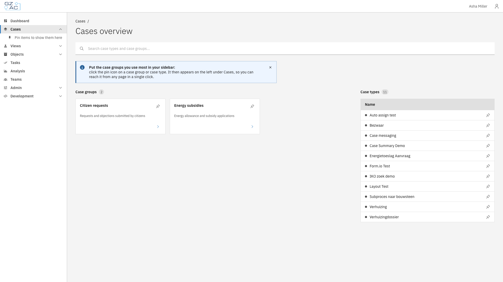
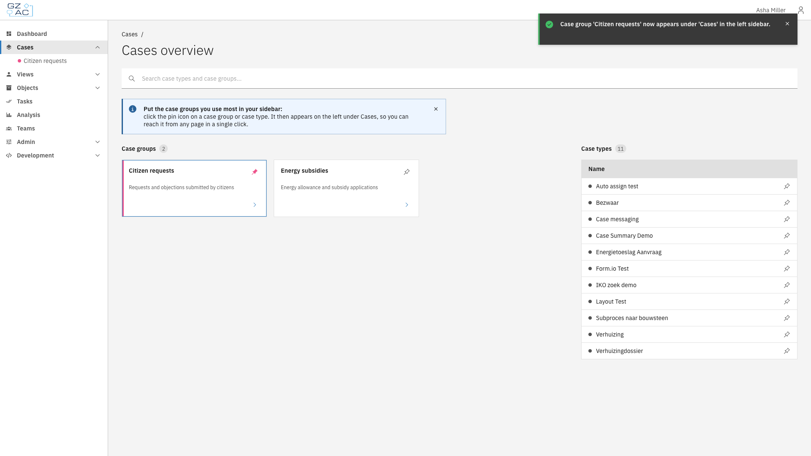
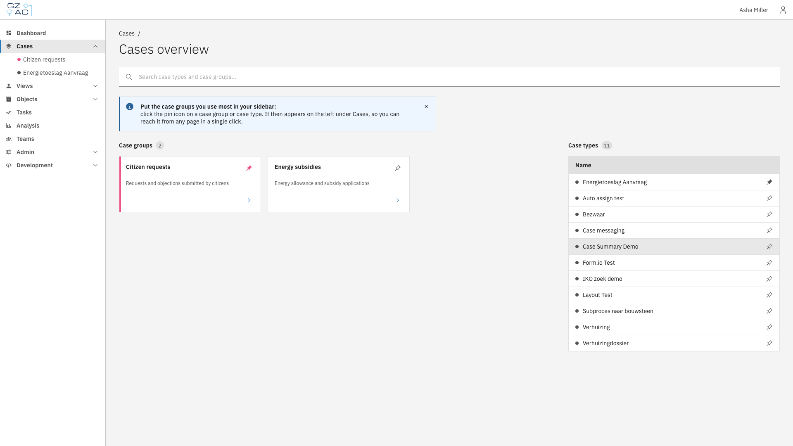
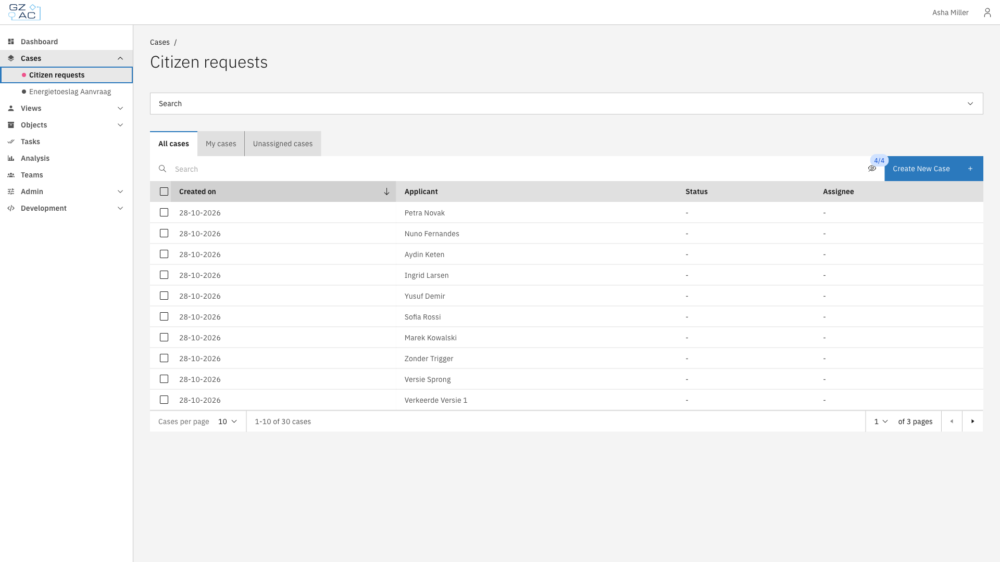
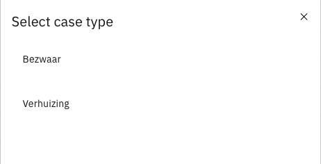
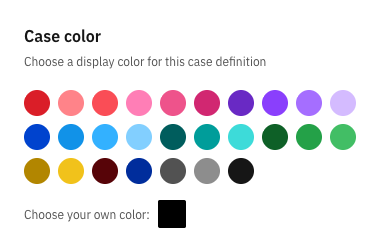
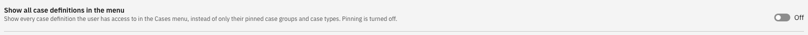
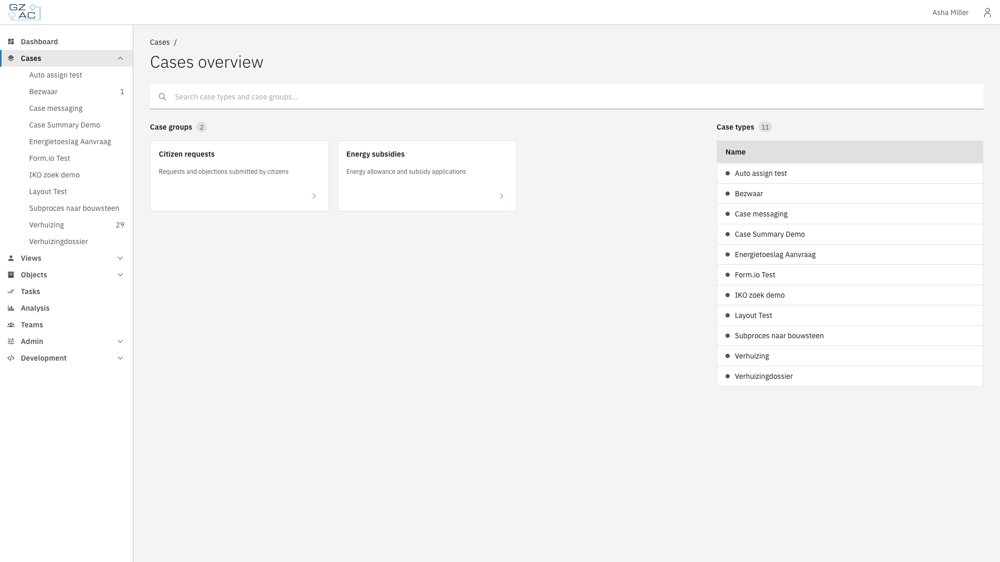

# Cases overview & pinning


Available since Valtimo `13.52.0`


The Cases overview is the starting point for end users to find their cases. It lists all
[case groups](case-groups/README.md) and case types the user has access to. Users pin the items
they use most, so these appear directly under **Cases** in the left sidebar.

This page describes what end users see, and which settings administrators use to influence it.

---

## Cases overview

Users open the Cases overview by clicking **Cases** in the left sidebar.

<figure><figcaption>Cases overview</figcaption></figure>

The page has two sections:

| Section | Description |
|---------|-------------|
| Case groups | A tile per case group with its name and description. Clicking the arrow opens the case list of the group. |
| Case types | A row per case definition. Clicking the name opens the case list of that case definition. |

Pinned items are shown first in each section, followed by the other items in alphabetical order.
Use the **Search case types and case groups...** field to filter both sections on name or
description.

The overview only shows case definitions for which the user has the `view_list` permission, and
case groups that contain at least one of those case definitions.

---

## Pinning items to the sidebar



Click **Cases** in the left sidebar to open the Cases overview


Click the pin icon on a case group tile or case type row

<figure><figcaption>Pinning a case group</figcaption></figure>



A message confirms that the item now appears under **Cases** in the left sidebar. Pinned items are
listed in alphabetical order, each with a dot in the color of the case group or case definition.

<figure><figcaption>Pinned items in the sidebar</figcaption></figure>

Click the pin icon again to unpin an item. Pinned items are personal: each user has their own
selection. As long as nothing is pinned, the sidebar shows **Pin items to show them here**.

---

## Case list of a case group

Clicking a pinned case group, or the arrow on its tile, opens the case list of the group. It shows
the cases of all case definitions in the group, using the
[list columns](case-groups/list-columns.md) and [search fields](case-groups/search-fields.md) of
the group.

<figure><figcaption>Case list of a case group</figcaption></figure>

When a user clicks **Create New Case**, they first select which case type to start. If the user
can start only one case definition in the group, this step is skipped.

<figure><figcaption>Select case type</figcaption></figure>

---

## Case colors

The dot in front of a pinned case type uses the color of the case definition. Administrators set
this color in the **Case color** panel on the [General](general.md) tab of the case definition.
Case groups have their own [group color](case-groups/configuration.md#choosing-a-group-color).

<figure><figcaption>Case color</figcaption></figure>

Items without a color are shown with a neutral gray dot.

---

## Showing all case definitions in the menu

Instead of pinned items, the **Cases** menu can list every case definition the user has access to.
This is controlled by a feature toggle.



Expand **Admin** in the left sidebar and click **Settings**


Click the **Feature toggles** tab


Switch **Show all case definitions in the menu** on or off

<figure><figcaption>Show all case definitions in the menu</figcaption></figure>



When the toggle is on:

- The **Cases** menu lists all case definitions in alphabetical order, with the number of open
  cases.
- Pinning is turned off: pin icons and colored dots are not shown.
- Case groups are still available from the Cases overview.

<figure><figcaption>Menu with all case definitions</figcaption></figure>


Existing installations that upgrade to Valtimo `13.52.0` get this toggle switched **on**, so the
menu keeps showing all case definitions as before. New installations start with the toggle
**off** and use pinning. The toggle replaces the earlier generic case list ("All cases"), which is
no longer available.

