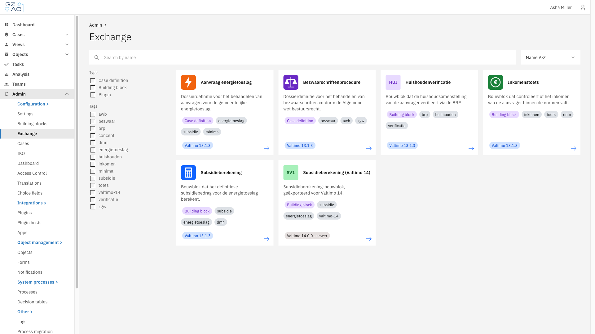
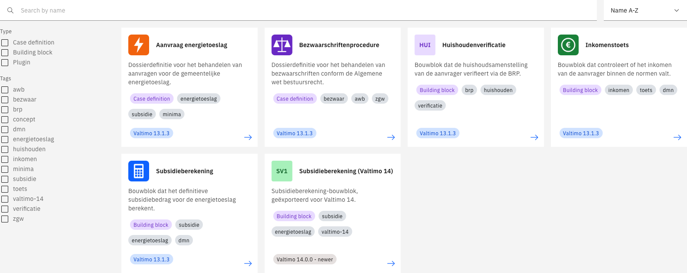
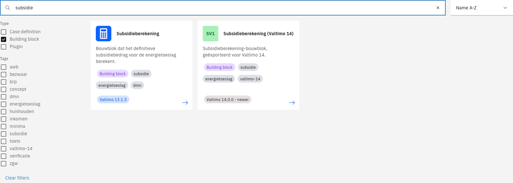
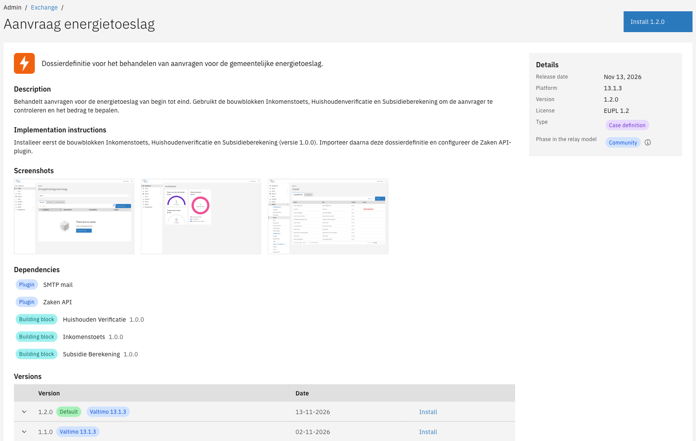
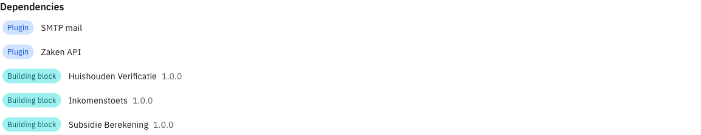
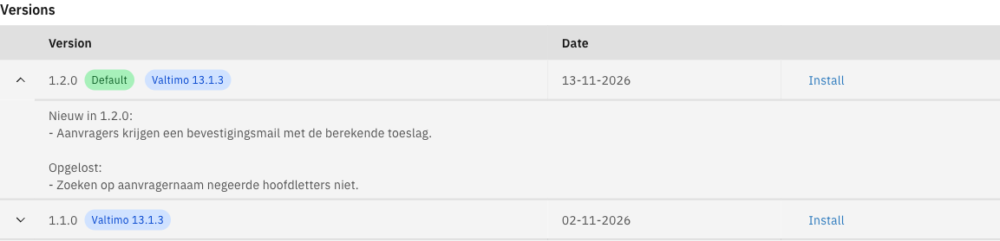
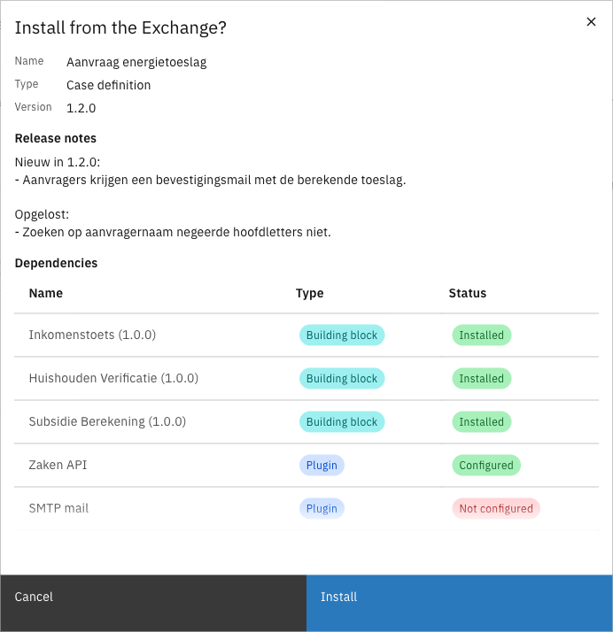

# Exchange


Available since Valtimo `13.55.0`


The GZAC Exchange is a shared catalog of case definitions, building blocks and plugins published by
organizations that use Valtimo. The **Exchange** page lets administrators browse this catalog
inside Valtimo and install a case definition or building block in a few steps, using the regular
import of case definitions and building blocks.

The **Exchange** page is only available to administrators. Which Exchange Valtimo connects to is
set by the operator of the environment; there is nothing to configure in the admin interface. When
no Exchange is set, the menu item is hidden.



Expand **Admin** in the left sidebar


Click **Exchange** under **Configuration**

<figure><figcaption>Exchange in the Admin menu</figcaption></figure>



---

## Finding a publication

Each item in the catalog is a publication. A tile shows its name, short description, type, tags and
the Valtimo version it was built for.

<figure><figcaption>Exchange catalog</figcaption></figure>

Narrow down the catalog with the controls above and next to the tiles:

| Control | Description |
|---------|-------------|
| **Search by name** | Shows the publications whose name contains the search term. |
| **Sort by** | Sorts the tiles by **Name A-Z** or **Most recent**. |
| **Type** | Shows only publications of the selected types: case definitions, building blocks or plugins. |
| **Tags** | Shows only publications with the selected tags. |
| **Clear filters** | Clears the selected types and tags. The search term stays. |

<figure><figcaption>Building blocks matching "subsidie"</figcaption></figure>

When there are more publications than fit on one page, use the page navigation below the tiles. The
search, filters and page are part of the page address, so a filtered catalog can be bookmarked or
shared with another administrator.

The Valtimo version tag on a tile shows which Valtimo version the publication was built for. A gray
tag ending in **newer** means it was built for a newer Valtimo version than this environment runs.

---

## Viewing a publication

Click a tile to open the publication.

<figure><figcaption>Publication details</figcaption></figure>

The page contains the following sections:

| Section | Description |
|---------|-------------|
| **Description** and **Implementation instructions** | What the publication does and what to do before or after installing it. |
| **Screenshots** | Click a screenshot to view it full size. Use the arrows or the arrow keys to browse. |
| **Dependencies** | The plugins and building blocks the default version needs. |
| **Versions** | All versions of the publication, with their date and the Valtimo version they were built for. |
| **Details** | Release date, platform version, version, license, type and repository of the default version. |
| **Phase in the relay model** | How mature the publication is: **Help Wanted**, **Community**, **Candidate** or **Hall of Fame**. Click the information icon for an explanation of the phase and what is needed for the next one. |
| **Publisher** | The organization that published it, with a link to its website. |

<figure><figcaption>Dependencies</figcaption></figure>

Click the arrow at the start of a version to show its release notes.

<figure><figcaption>Release notes of a version</figcaption></figure>

---

## Installing a case definition or building block

Installing downloads the publication from the Exchange and opens the regular import for it. Nothing
is imported until you finish that import.



Open the publication and click **Install** in the page header to install the default version, or
**Install** in the row of another version in **Versions**


Check the confirmation

<figure><figcaption>Install confirmation</figcaption></figure>

The confirmation shows the version, its release notes and whether its dependencies are available in
this environment:

| Status | Meaning |
|--------|---------|
| **Installed** | The building block is installed in this environment. |
| **Not installed** | The building block is missing. Install it first, or the case definition may not work. |
| **Configured** | A configuration of the plugin exists in this environment. |
| **Not configured** | No configuration of the plugin exists yet. Add one before using the case definition. |
| **Couldn't check** | Valtimo could not determine the status. |

A warning is shown when the version was built for a newer Valtimo version than this environment
runs.


Click **Install**


Complete the import. A case definition opens the same wizard as
[uploading a case](cases/README.md#uploading-a-case), with the file already selected. A building
block opens the same upload as [importing a building block](building-blocks/README.md#import-and-export).


After the import, Valtimo opens the imported case definition or building block




Plugins can be found in the Exchange but cannot be installed from Valtimo. A publication that cannot
be installed shows a message on its page, and a **View repository** button when it has a
repository.

