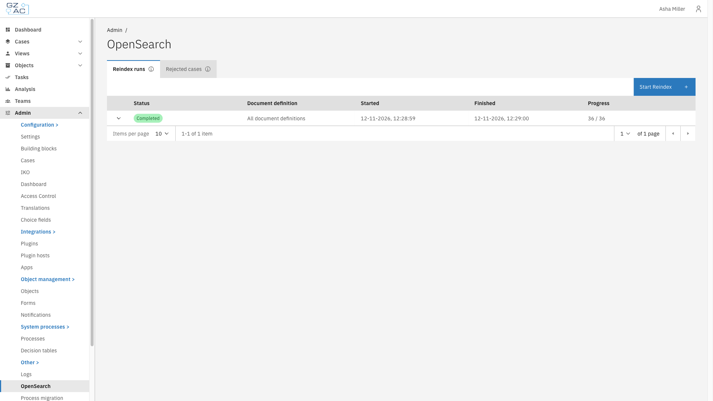
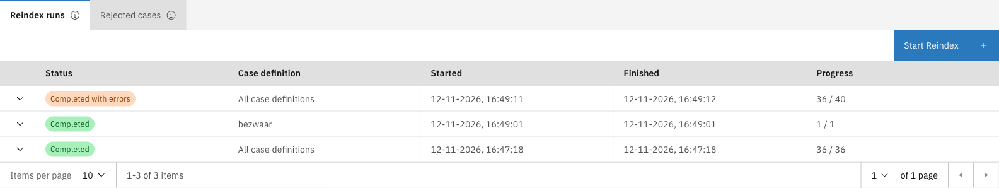
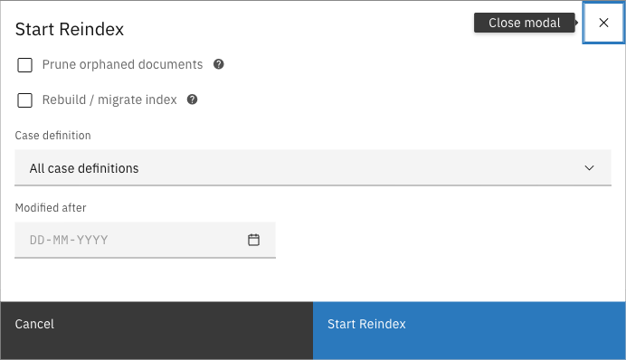
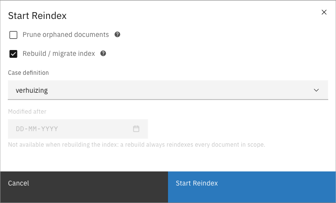
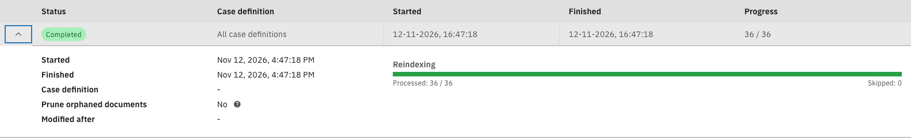
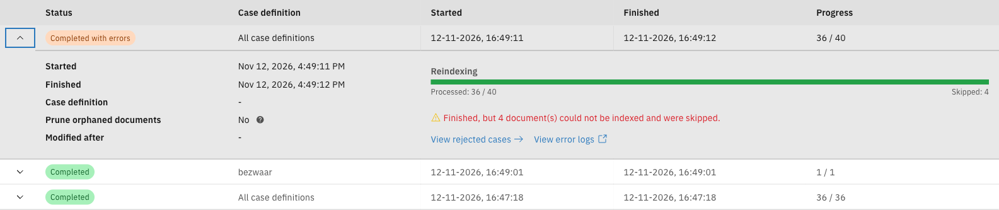
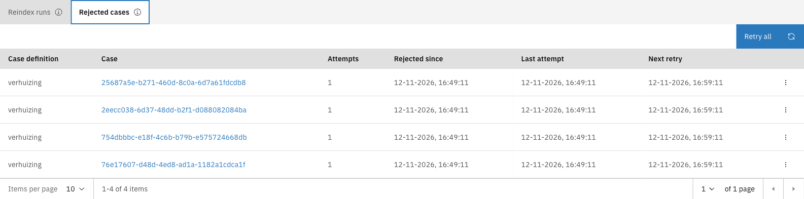

# OpenSearch


Available since Valtimo `13.44.0`. The rebuild/migrate index, the rejected-cases list and the
automatic background indexing of existing cases were added in `13.55.0`.


Valtimo can use OpenSearch to power case-list search instead of the database. The **OpenSearch**
admin screen lets you reindex cases into OpenSearch, watch those reindex runs, and see any cases
OpenSearch could not index. Whenever OpenSearch is unavailable, still catching up, or has rejected
a case, the affected case lists fall back to the database (PostgreSQL) so they keep working.

The screen is reached via **Admin → OpenSearch** (under the *Other* section of the admin menu). It
appears only when OpenSearch is enabled for the installation.

The screen is split into two tabs — **Reindex runs** and **Rejected cases**. The information icon in
each tab header explains what that tab is for.

<figure><figcaption>The OpenSearch admin screen</figcaption></figure>

---

## Reindex runs

A reindex copies cases from the database into OpenSearch. It runs in the background, so you can
leave the screen while it works. The **Reindex runs** tab lists each run with its status, the
case definition it covered, its start and finish time, and progress.

<figure><figcaption>The Reindex runs tab</figcaption></figure>

### Starting a reindex



Expand **Admin** in the left sidebar and click **OpenSearch** under the *Other* section


On the **Reindex runs** tab (open by default), click **Start Reindex**


Choose the reindex options

<figure><figcaption>The Start Reindex options</figcaption></figure>


Click **Start Reindex** to begin. The new run appears at the top of the list.

<figure><figcaption>A reindex scoped to one case definition</figcaption></figure>



The **Start Reindex** button is disabled while a run is already in progress.

#### Reindex options

| Option | Description |
|--------|-------------|
| Prune orphaned documents | Remove entries from OpenSearch that no longer exist in the database. |
| Rebuild / migrate index | Rebuild the index into a fresh one and swap it in without downtime. For a run over all case definitions this also migrates off the legacy shared index to one index per case definition. |
| Case definition | Limit the reindex to a single case definition. Leave on **All case definitions** to reindex every case definition. |
| Modified after | Only reindex cases changed after the chosen date. Not available when **Rebuild / migrate index** is enabled — a rebuild always reindexes every case in scope. |

### Run status

| Status | Meaning |
|--------|---------|
| Running | The run is in progress. |
| Pruning orphaned documents | The run is removing search entries that no longer exist in the database. |
| Completed | Every case in scope was indexed. |
| Completed with errors | The run finished, but one or more cases could not be indexed and were skipped. |
| Failed | The run could not finish. |
| Stopped | The run was stopped before it finished. |

### Run details

Expand a run with the chevron on the left of its row to see its parameters (start and finish time,
case definition, prune and modified-after settings) and progress. Progress bars show the
reindexing — and, when enabled, the pruning — phase.

<figure><figcaption>An expanded completed run</figcaption></figure>

When a run ends as **Completed with errors**, it offers two links: **View rejected cases** opens the
**Rejected cases** tab, and **View error logs** jumps to the application log filtered to that run,
where the reason for each skipped case is recorded. A **Failed** run offers the **View error logs**
link.

<figure><figcaption>An expanded run with skipped cases</figcaption></figure>

---

## Status notifications

Notifications at the top of the screen, above the tabs, explain when case search is temporarily
using the database instead of OpenSearch. No action is required unless a notification asks for one.

| Notification | Meaning |
|--------------|---------|
| **Index rebuild required** | The installation still uses the legacy document-search index, or one or more case definitions have no index yet. Start a reindex with **Rebuild / migrate index** enabled to migrate to the per-case-definition indices. Search uses the database until the migration completes. |
| **Indexing existing cases** | OpenSearch is indexing existing cases in the background. Search uses the database until this finishes. No action is needed. |
| **Some cases are searched in the database** | OpenSearch could not index some cases of the listed case definitions. Their case lists use the database in the meantime. These cases are listed on the **Rejected cases** tab. |

<figure><figcaption>A database-fallback notification</figcaption></figure>

---

## Rejected cases

When OpenSearch cannot index a case, it is listed on the **Rejected cases** tab. Until a rejected
case is indexed, the case lists of its case definition use the database. OpenSearch retries rejected cases
automatically at growing intervals: after 10 minutes, then hourly, then daily. The reason for each
rejection is recorded in the application log.

<figure><figcaption>The Rejected cases tab</figcaption></figure>

The **Rejected cases** tab is always available; when every case is indexed it shows an empty state.

#### Columns

| Column | Description |
|--------|-------------|
| Case definition | The case definition the rejected case belongs to. |
| Case | A link to the rejected case. |
| Attempts | How many times indexing has been tried. |
| Rejected since | When the case was first rejected. |
| Last attempt | When indexing was last tried. |
| Next retry | When the next automatic retry is scheduled. |

### Retrying rejected cases

After fixing the cause of a rejection, you can retry without waiting for the next automatic round:

- **Retry now** — on the overflow menu (three dots) at the end of a case's row, retries that single
  case. If the case is indexed it leaves the list; if it no longer exists it is removed; if it is
  still rejected, the reason remains in the application log.
- **Retry all** — in the toolbar, schedules every rejected case to be retried on the next indexing
  round within a few minutes. You are asked to confirm first.
