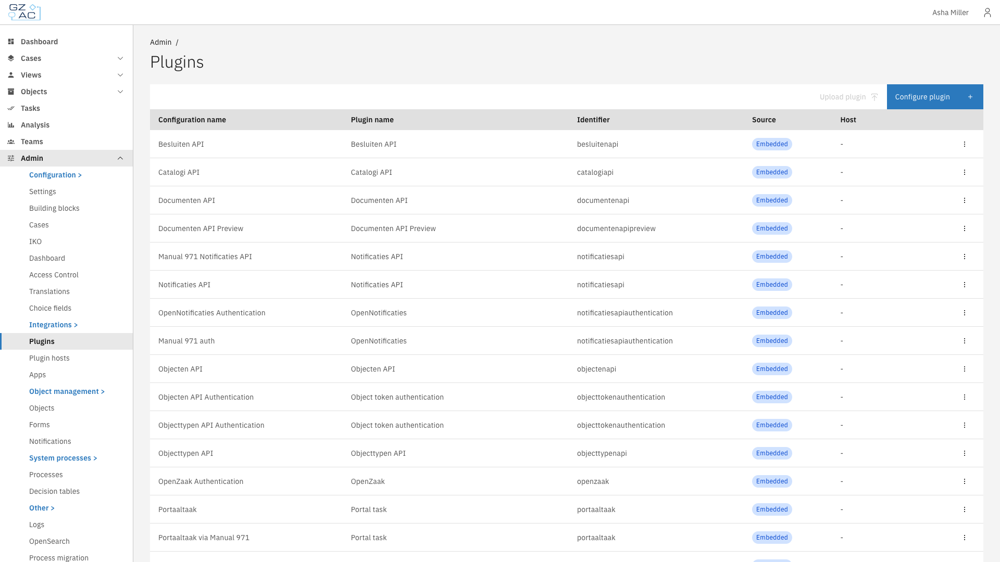
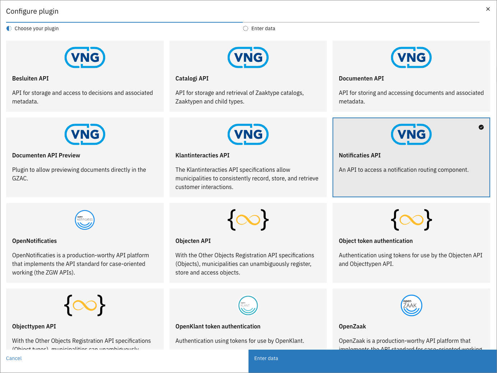
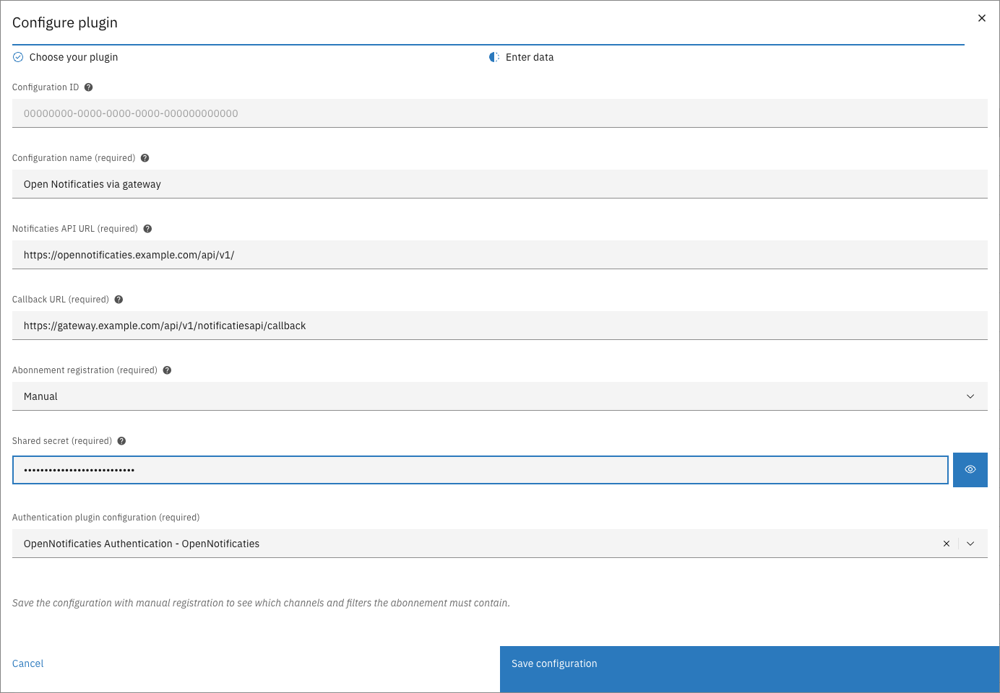
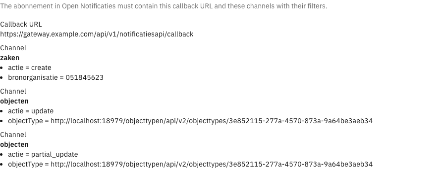

# Notificaties API


The Notificaties API plugin is a ZGW plugin and can only be used in the GZAC edition.


The Notificaties API plugin connects Valtimo to Open Notificaties, the component that routes
notificaties between ZGW APIs. Valtimo receives notificaties through an abonnement (subscription)
in Open Notificaties: the abonnement names the callback URL of Valtimo, the channels (kanalen) to
follow and the filters per channel, and a secret that Open Notificaties sends along with every
notificatie.

Each Notificaties API plugin configuration chooses how that abonnement is registered:

| Abonnement registration | Who creates the abonnement | When to use |
|-------------------------|----------------------------|-------------|
| **Automatic** | Valtimo registers, updates and removes the abonnement and the channels it needs. | The default. Use it when Open Notificaties can reach Valtimo directly. |
| **Manual** | An administrator creates the abonnement in the Open Notificaties admin. Valtimo creates, changes and removes nothing in Open Notificaties for this configuration. | When all traffic between systems goes through a gateway that checks certificates. During automatic registration Open Notificaties sends a test message to the callback URL; such a gateway refuses it, so automatic registration fails. |

Existing configurations, and new configurations that do not change the setting, use **Automatic**.

---

## Configuring the Notificaties API plugin



Expand **Admin** in the left sidebar and click **Plugins**

<figure><figcaption>Plugins page</figcaption></figure>


Click **Configure plugin**, select **Notificaties API** and click **Enter data**

<figure><figcaption>Choosing the Notificaties API plugin</figcaption></figure>


Fill in the properties and click **Save configuration**



To change an existing configuration, click its row on the **Plugins** page, change the
properties and click **Save configuration**.

| Property | Description |
|----------|-------------|
| Configuration name | The name under which the configuration can be found in the rest of the application. |
| Notificaties API URL | The URL of the REST API of Open Notificaties, for example `https://opennotificaties.example.com/api/v1/`. |
| Callback URL | The address where Open Notificaties sends notificaties: the GZAC back-end URL followed by `/api/v1/notificatiesapi/callback`. With a gateway, use the address through which Open Notificaties reaches Valtimo via the gateway. |
| Abonnement registration | **Automatic** or **Manual**. See the table above. |
| Authentication header | Shown with **Automatic**. The secret that Valtimo places on the abonnement it registers. When left empty, Valtimo generates a random secret. After changing it, remove the abonnement in Open Notificaties and restart the application, so that Valtimo registers it again with the new value. |
| Shared secret | Shown with **Manual**, and required. The secret that the administrator also enters on the abonnement in Open Notificaties. Valtimo only accepts notificaties that carry this secret. |
| Authentication plugin configuration | The authentication plugin configuration that Valtimo uses to call Open Notificaties, for example to publish notificaties. Required for both registration types. |

---

## Registering the abonnement manually


Manual abonnement registration is available since Valtimo `13.52.0`


### Setting the configuration to Manual



Open a new or existing Notificaties API configuration, as described above


Select **Manual** in **Abonnement registration**


Enter a **Shared secret**

Use a long, random, plain value. Do not start it with `Bearer `: Valtimo treats such a value as a
login token, and the notificatie is not accepted.

<figure><figcaption>Manual registration with a shared secret</figcaption></figure>


Click **Save configuration**

**Save configuration** stays disabled while **Shared secret** is empty.



### Viewing what the abonnement must contain

After a configuration is saved with **Manual**, its form shows what the abonnement in Open
Notificaties must contain: the callback URL, and every channel with its filters. For a new
configuration the form asks to save it first.



On the **Plugins** page, click the row of the configuration


Scroll down below the properties

<figure><figcaption>Callback URL and channels with filters</figcaption></figure>



The list contains only the channels and filters that belong to this configuration: those of the
**Receive a notification** process links that use it, and those of other plugin configurations
that point to it, such as **Verzoek** and **Portaaltaak**. The same channel can appear more than
once, each time with other filters. The list changes when such a process link or plugin
configuration is added, changed or removed; update the abonnement in Open Notificaties to match.

### Creating the abonnement in Open Notificaties

In the admin of Open Notificaties:



Make sure every channel in the list exists, and that the filters of each channel allow the
filters listed for it. Open Notificaties refuses an abonnement whose filters do not match the
filters of the channel.


Create an abonnement with the **Callback URL** shown in Valtimo


Enter the **Shared secret** of the configuration in the **Auth** field of the abonnement


Add an entry for every channel in the list, with exactly the filters shown for it. Add a channel
that appears more than once as a separate entry for each set of filters.



Valtimo accepts a notificatie on the callback URL when it carries the shared secret of a
configuration set to **Manual**, or the secret of an abonnement that Valtimo registered for a
configuration set to **Automatic**. Other notificaties are refused and not processed.

### Things to keep in mind


**Switching an existing configuration to Manual.** The abonnement that Valtimo registered earlier
for the configuration stays in Open Notificaties, and Valtimo no longer accepts notificaties that
carry its old secret. Remove that abonnement in Open Notificaties, or keep it and enter its
**Auth** value as the shared secret of the configuration.



**Automatic and Manual on the same Open Notificaties.** Valtimo normally removes abonnementen with
its callback URL that it does not know, so duplicate abonnementen do not pile up. On an Open
Notificaties URL that has a configuration set to **Manual**, Valtimo skips that clean-up, because
it cannot tell the administrator's abonnement apart from a duplicate. Remove duplicate abonnementen
there by hand. The channels and filters that belong to a **Manual** configuration are also left
out of the abonnement that Valtimo registers for an **Automatic** configuration; those
notificaties arrive through the administrator's abonnement.



The shared secret is stored and exported as a plain value, like the other properties that are not
marked as secret. A plugin configuration export therefore contains it; store export files
accordingly.



Deleting a configuration set to **Manual** does not remove its abonnement from Open Notificaties.
Remove it there by hand. Once no configuration on that Open Notificaties is set to **Manual**, an
**Automatic** configuration with the same callback URL removes abonnementen it does not recognise
again, and that can include the one the administrator created.

