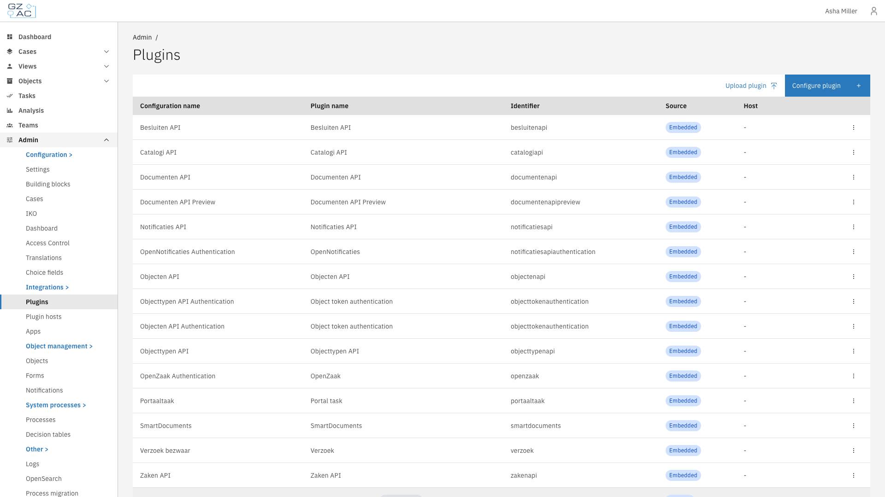
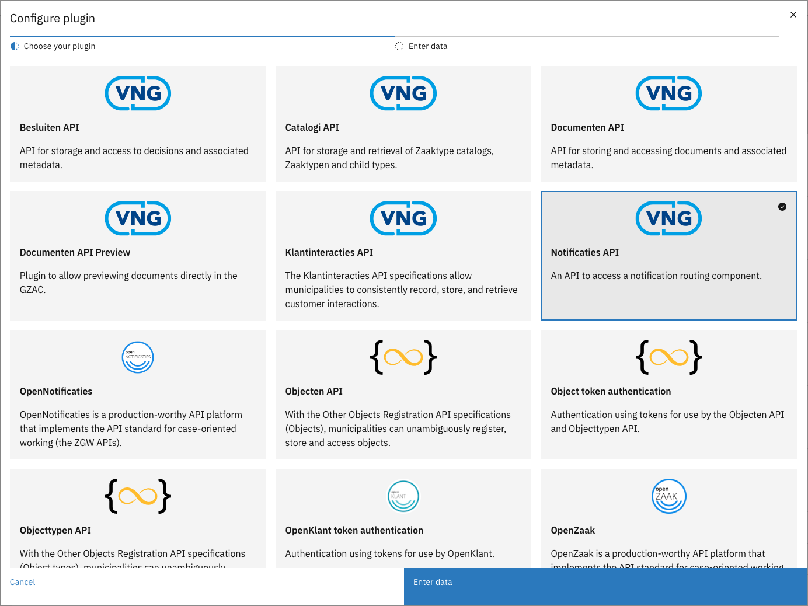
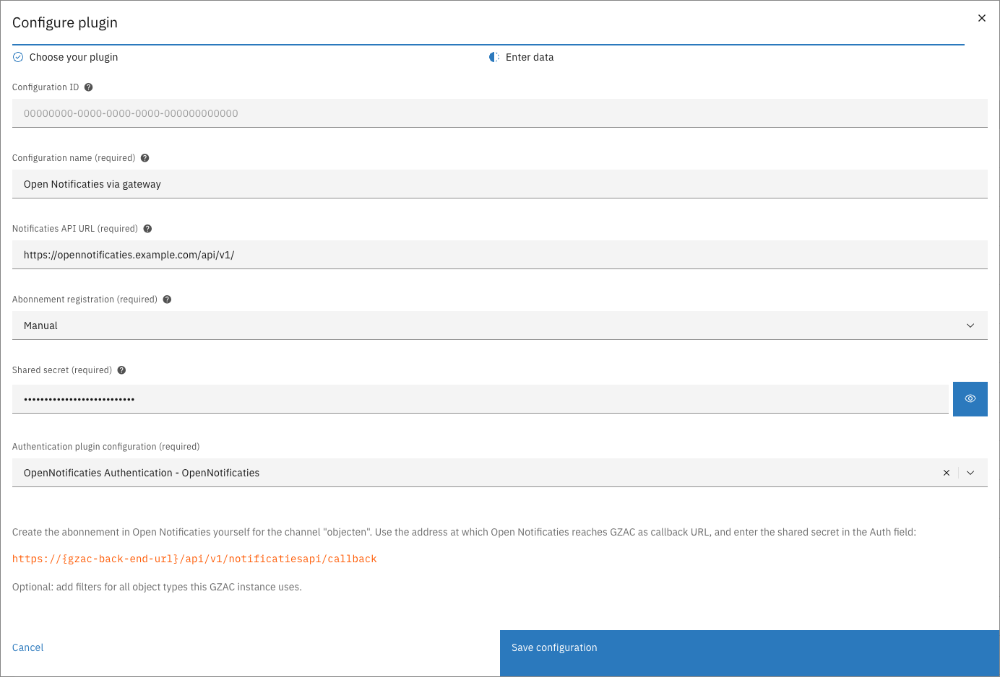

# Notificaties API


The Notificaties API plugin is a ZGW plugin and can only be used in the GZAC edition.


The Notificaties API plugin connects Valtimo to Open Notificaties. Open Notificaties passes on
messages (notificaties) between ZGW systems, for example when a zaak is created. Valtimo only
receives these notificaties when it has a subscription (abonnement) in Open Notificaties.

Each configuration of the plugin sets who creates that abonnement:

| Abonnement registration | Who creates the abonnement                                    | When to use                                                                                                                                                                                    |
|-------------------------|---------------------------------------------------------------|------------------------------------------------------------------------------------------------------------------------------------------------------------------------------------------------|
| **Automatic**           | Valtimo creates and maintains the abonnement itself.          | In most environments. This is the default.                                                                                                                                                     |
| **Manual**              | An administrator creates the abonnement in Open Notificaties. | When all traffic to Valtimo passes through a gateway that checks certificates. Such a gateway blocks the test message that Open Notificaties sends when Valtimo creates the abonnement itself. |

---

## Configuring the Notificaties API plugin



Expand **Admin** in the left sidebar and click **Plugins**

<figure><figcaption>Plugins page</figcaption></figure>


Click **Configure plugin**, select **Notificaties API** and click **Enter data**

<figure><figcaption>Choosing the Notificaties API plugin</figcaption></figure>


Fill in the properties and click **Save configuration**



To change an existing configuration, click its row on the **Plugins** page.

| Property                            | Description                                                                                                                                                                                                       |
|-------------------------------------|-------------------------------------------------------------------------------------------------------------------------------------------------------------------------------------------------------------------|
| Configuration name                  | The name under which the configuration appears elsewhere in Valtimo.                                                                                                                                              |
| Notificaties API URL                | The address of Open Notificaties, for example `https://opennotificaties.example.com/api/v1/`.                                                                                                                     |
| Abonnement registration             | **Automatic** or **Manual**, see the table above. Existing configurations use **Automatic**.                                                                                                                      |
| Callback URL                        | Only with **Automatic**. The address at which Open Notificaties reaches Valtimo. It ends in `/api/v1/notificatiesapi/callback`.                                                                                   |
| Authentication header               | Only with **Automatic**, optional. A secret that Open Notificaties sends along with every notificatie. Leave it empty to let Valtimo choose one. A changed value is passed on to Open Notificaties when you save. |
| Shared secret                       | Only with **Manual**, required. The secret that you also enter in the abonnement in Open Notificaties.                                                                                                            |
| Authentication plugin configuration | The configuration that Valtimo uses to log in to Open Notificaties.                                                                                                                                               |

---

## Registering the abonnement manually


Manual abonnement registration is available since Valtimo `13.53.0`


### Setting the configuration to Manual



Open a new or existing Notificaties API configuration


Select **Manual** in **Abonnement registration**

The **Callback URL** field disappears, because with **Manual** the callback URL is only entered
in Open Notificaties. Instead, a help text appears below the properties. It shows the callback URL
to use, and reminds you to add the channels and filters to the abonnement. You do not have to save
first to see it.


Enter a **Shared secret**

Choose a long, random value. Do not start it with `Bearer `, or Valtimo refuses the notificaties.

<figure><figcaption>Manual registration with a shared secret, and the help text below it</figcaption></figure>


Click **Save configuration**



### Creating the abonnement in Open Notificaties

In the admin of Open Notificaties:



Create an abonnement with the callback URL
`https://{gzac-back-end-url}/api/v1/notificatiesapi/callback`. Replace `{gzac-back-end-url}`
with the address at which Open Notificaties reaches Valtimo, such as the address of the gateway.


Enter the **Shared secret** in the **Auth** field of the abonnement. Leave the authorization type
on **API key**.


Add the channels (kanalen) that the processes and plugins using this configuration listen to,
such as **Verzoek** and **Portaaltaak**, each with the filters they need. Check that every channel
exists and allows those filters; Open Notificaties refuses an abonnement with filters that its
channel does not allow.



When such a process or plugin changes, update the abonnement to match.

### Good to know


**Switching an existing configuration to Manual.** The abonnement that Valtimo created earlier
stays in Open Notificaties, but no longer works. Remove it, or keep it and enter its **Auth**
value as the shared secret.



**Duplicate abonnementen.** Valtimo normally removes leftover abonnementen that it created. While a
configuration is set to **Manual**, it skips this, because it cannot tell them apart from the
abonnement you created. Remove duplicates in Open Notificaties yourself.



**Deleting a Manual configuration** does not remove its abonnement from Open Notificaties. Remove
it there. Once no configuration is set to **Manual**, Valtimo may remove it during its clean-up.



**Exports.** A plugin configuration export contains the shared secret as readable text. Store
export files accordingly.

