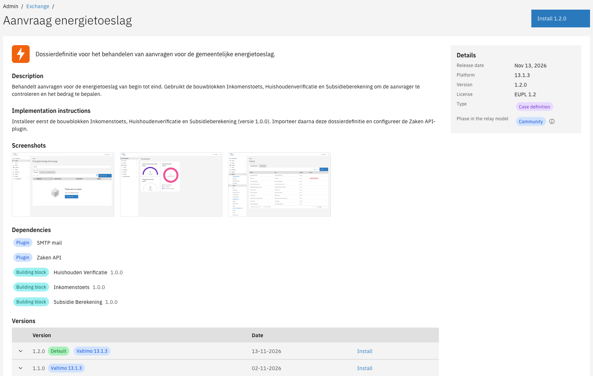

# 13.55.0

Release date: 18-11-2026

---

## New Features

### Install from the GZAC Exchange

Find and install case definitions and building blocks from the GZAC Exchange without leaving
Valtimo. Go to **Admin** > **Exchange** to search and filter the catalog, read a publication's
description, dependencies and release notes, and click **Install**. Valtimo shows which
dependencies are already available, imports the publication through the regular import and then
opens the imported case definition or building block.

<figure><figcaption>Publication in the Exchange</figcaption></figure>

**[Try it out →](../../../configuration-guides/exchange.md)**
